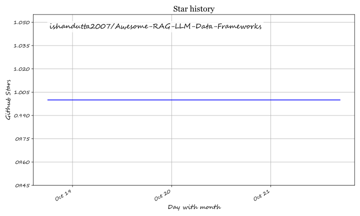

# 🚀 Awesome RAG & LLM Data Frameworks

  

  
  
  
  
  
  
  

---

## 📌 Executive Summary & Ecosystem Focus

A curated directory and developer guide to the top **Retrieval-Augmented Generation (RAG)** and **Large Language Model (LLM) Data Frameworks**. This index covers production-tested SaaS platforms, enterprise managed vector databases, multimodal ingestion pipelines, and battle-tested open-source repositories designed to ground generative AI on enterprise private data.

> [!NOTE]
> **Key Focus Areas**: Document ETL & Parsing • Semantic & Hybrid Retrieval • Dense/Sparse Vector Search • Knowledge Graph HybridRAG • Context Engineering • Production RAG Observability & Evaluation.

---

## 📑 Table of Contents

- [📊 Sector Overview & Market Dynamics](#-sector-overview--market-dynamics)
- [🏢 SaaS & Hosted Platforms](#-saas--hosted-platforms)
- [💻 Open-Source GitHub Projects](#-open-source-github-projects)
- [🛠️ Architectural Selection Matrix](#️-architectural-selection-matrix)
- [🤝 How to Contribute](#-how-to-contribute)
- [⭐ Star History](#-star-history)
- [💖 Support & Sponsorship](#-support--sponsorship)
- [⚖️ Disclaimer](#️-disclaimer)

---

## 📊 Sector Overview & Market Dynamics

The global **Retrieval-Augmented Generation (RAG) and LLM Data Infrastructure** market is estimated at **$2.5B–$4.0B in 2025–2026** and is projected to expand past **$40B by 2034**, advancing at a Compound Annual Growth Rate (**CAGR of 38%–43%**).

Market structure across this ecosystem is **bifurcated and moderately fragmented**:
- **Infrastructure & Foundational Compute Tier**: Concentrated among major cloud hyperscalers (AWS Bedrock, Azure AI Search, Google Cloud Vertex AI, and OpenAI) providing base models and managed host environments.
- **RAG Orchestration, Vector Search & Data Ingestion Tier**: **Highly fragmented and fiercely competitive**. Specialized startups and open-source frameworks (such as LlamaIndex, Dify, LangChain, Qdrant, Milvus, and Weaviate) dominate developer adoption and rapid algorithmic innovation, preventing single-vendor "winner-take-all" lock-in and driving multi-vendor composable RAG architectures.

---

## 🏢 SaaS & Hosted Platforms

The table below catalogs premier hosted RAG engines, managed vector databases, and document parsing APIs, sorted in **descending order by company scale (valuation or annual revenue)**.

| 🏢 Platform / Provider | 📈 Company Scale (Valuation / Revenue) | 💵 Starting Tier Pricing | 🎁 Free Tier / Trial Limits | 🎯 Core Capabilities & Best For |
| :--- | :--- | :--- | :--- | :--- |
| **[Elasticsearch Vector Database](https://www.elastic.co/)** | **Public (NYSE: ESTC)** Valuation: ~$8.5B Market Cap Revenue: $1.3B+ ARR | **$95.00/month** (Elastic Cloud Hosted Standard) or Serverless consumption ($0.05/GB storage + $0.08/VCU-hr) | **14-day free trial** with full platform access and up to **$300 cloud credit allowance** (no credit card required) | **Enterprise Hybrid Vector & Lexical Search**. Better Binary Quantization (BBQ/DiskBBQ), native Jina AI inference, and serverless vector indexing where enterprise logs and records already reside. |
| **[Pinecone Nexus](https://www.pinecone.io/)** | **Private** Valuation: $750M Funding: $138M (Series B led by A16Z) | **$20.00/month** (Builder Plan) or $50.00/month minimum commitment (Standard Plan) | **Free Forever (Starter Plan)**: Up to **2 GB index storage** (~300,000 vectors for 1536-dim), **2M write units/mo**, **1M read units/mo**, 5 serverless indexes, 100 namespaces/index | **Serverless Retrieval-Native RAG**. Distills raw corpora into typed artifacts (summaries, entities, events) queried via a Python retrieval SDK with SQL-like exact count handling. |
| **[Unstructured.io](https://unstructured.io/)** | **Private** Valuation: $230M Funding: $65M (Series B led by Menlo & Databricks) | **$0.015 per page** (Serverless Pay-As-You-Go API) | **10,000 free pages** Non-expiring one-time account credit with full parser access upon signup (no credit card required) | **Universal Multimodal Document Preprocessing & ETL**. Extracts, partitions, chunks, and structures tables, images, and unstructured data across 40+ formats (PDF, DOCX, PPTX). |
| **[Weaviate Cloud](https://weaviate.io/)** | **Private** Valuation: ~$200M Funding: $67M (Series B led by Index Ventures) | **$45.00/month** minimum commitment (Flex Serverless Tier) | **Free Forever (Sandbox/Free Tier)**: 1 cluster, **100,000 objects**, **1 GB memory**, **10 GB disk**, 1 collection, 2,000 embedding req/day, 1,000 Query Agent req/mo | **Hybrid Search & Agentic Context Memory**. BM25 + dense vectors with Reciprocal Rank Fusion (RRF), native Query Agent, Engram context memory service, and built-in MCP server integration. |
| **[Vectara](https://www.vectara.com/)** | **Private** Valuation: ~$150M Funding: $53M+ (Series A led by Race Capital) | **$100,000/year** (~$8,333/month floor for Enterprise SaaS contract) | **30-day free trial** Full access to agentic RAG search, multi-modal retrieval, generative summarization, and query evaluation credits | **Governed Enterprise Agentic RAG**. Step-level audit trails, Factual Consistency Score (HHEM-2.1), HIPAA/SOC 2 Type II compliance, and zero-training guarantees on customer data. |
| **[LlamaCloud](https://cloud.llamaindex.ai/)** | **Private** Valuation: ~$100M Funding: $27.5M (Series A led by Norwest & Greylock) | **$50.00/month** (Starter Plan, includes 40,000 credits/month) | **Free Forever (Free Tier)**: **10,000 credits/month** (~1,000–3,300 pages depending on parsing mode), 5 concurrent jobs, **10 GB storage** (max 10,000 files), 1 user | **Document Parsing & Managed Ingestion Pipelines**. LlamaParse provides state-of-the-art layout-aware document extraction for complex financial tables, forms, and embedded charts. |
| **[Marqo Cloud](https://www.marqo.ai/)** | **Private** Valuation: ~$50M Funding: $18.4M (Series A led by Lightspeed) | **$0.14/hour** (~$100.80/month for minimal dedicated CPU node) / AWS Marketplace custom contracts | **Free Evaluation Plan ($0)**: No-risk sandbox evaluation allowing real-catalog indexing with ROI and conversion analysis reports | **Multimodal Vector Search & Product Discovery**. Combines lexical and neural embeddings (SBERT + OpenSearch) with behavioral fine-tuning, optimized for e-commerce and visual discovery. |

---

## 💻 Open-Source GitHub Projects

Explore the leading self-hosted, Apache-2.0, MIT, and open-source RAG engines, vector search databases, and LLM data orchestration libraries. The repositories below are **strictly ranked in descending order by GitHub stargazer count**, with real-time social badges linking directly to each repository's stargazers page.

### 1. [Dify](https://github.com/langgenius/dify) 
- **Primary Focus**: Production-ready LLM application development platform and agentic RAG workflow builder.
- **Key Features**: Visual drag-and-drop workflow orchestration, hybrid retrieval (vector + full-text), re-ranking models, automated document preprocessing, multi-model tool routing, and self-hosted Docker/K8s deployment.
- **License**: Apache-2.0

### 2. [LangChain / LangGraph](https://github.com/langchain-ai/langchain) 
- **Primary Focus**: Agent engineering, multi-actor state orchestration, and end-to-end LLM data pipelines.
- **Key Features**: Cyclical graph execution with LangGraph, durable checkpointing, human-in-the-loop workflows, LangSmith observability integration, and 700+ community integrations across retrievers and vector stores.
- **License**: MIT

### 3. [RAGFlow](https://github.com/infiniflow/ragflow) 
- **Primary Focus**: Deep document understanding and citation-backed enterprise RAG engine.
- **Key Features**: Intelligent OCR and vision-based document parsing for complex tables and spreadsheets, hybrid vector/BM25 retrieval, custom scoring, citation-grounded outputs, and visual agent builder.
- **License**: Apache-2.0

### 4. [Mem0](https://github.com/mem0ai/mem0) 
- **Primary Focus**: Intelligent memory layer for AI agents and personalized conversational RAG.
- **Key Features**: Multi-tiered memory architecture (User, Session, and AI Agent state), automatic memory extraction and deduplication, graph-enhanced memory associations, and sub-second recall.
- **License**: Apache-2.0

### 5. [LlamaIndex](https://github.com/run-llama/llama_index) 
- **Primary Focus**: Purpose-built data framework for indexing, connecting, and retrieving private enterprise data for LLMs.
- **Key Features**: 160+ data connectors via LlamaHub, advanced indexing (hierarchical, graph, sub-document, sentence-window), query engines, async-first concurrent retrievers, and built-in evaluation metrics.
- **License**: MIT

### 6. [Milvus](https://github.com/milvus-io/milvus) 
- **Primary Focus**: Distributed, cloud-native vector database engineered for billion-scale similarity search.
- **Key Features**: Storage-compute disaggregation, hardware acceleration (GPU/FPGA support), hybrid search (dense + sparse), dynamic schema support, and enterprise replication/sharding.
- **License**: Apache-2.0

### 7. [Qdrant](https://github.com/qdrant/qdrant) 
- **Primary Focus**: Ultra-fast vector database and semantic search engine written in Rust.
- **Key Features**: Payload-based filtering during HNSW graph traversal, native hybrid search (dense + BM25 via Reciprocal Rank Fusion), built-in fastembed models, quantization (scalar/binary), and sub-millisecond query latencies.
- **License**: Apache-2.0

### 8. [Onyx (formerly Danswer)](https://github.com/onyx-dot-app/onyx) 
- **Primary Focus**: Open-source enterprise workplace search, conversational RAG, and AI assistant platform.
- **Key Features**: Connectors to 40+ workplace platforms (Google Drive, Slack, Notion, Jira, Confluence, GitHub), document-level RBAC/permission sync, hybrid retrieval, and customizable personas.
- **License**: MIT

### 9. [FastGPT](https://github.com/labring/FastGPT) 
- **Primary Focus**: Knowledge-based question-answering platform built on LLMs with visual workflow configuration.
- **Key Features**: Automated data preprocessing, manual chunk refinement, vector search with re-ranking, visual DAG workflow editor, and OpenAPI-compatible endpoints.
- **License**: Apache-2.0

### 10. [Chroma](https://github.com/chroma-core/chroma) 
- **Primary Focus**: Open-source AI-native embedding database designed for rapid prototyping and local development.
- **Key Features**: Single-line `pip install chromadb`, zero-configuration persistent storage, built-in embedding functions, metadata filtering, and native client support in Python and JavaScript.
- **License**: Apache-2.0

### 11. [Haystack](https://github.com/deepset-ai/haystack) 
- **Primary Focus**: Modular, composable Python framework for building custom RAG pipelines and search systems.
- **Key Features**: Explicit component composition (Embedders, Retrievers, Generators, Routers), Hayhooks CLI for instant REST API and MCP server generation, document store abstraction, and evaluation tools.
- **License**: Apache-2.0

### 12. [Kotaemon](https://github.com/Cinnamon/kotaemon) 
- **Primary Focus**: Clean, customizable open-source RAG interface and framework for chatting with complex documents.
- **Key Features**: Multi-modal document QA, document preview with highlighted citation spans, hybrid retrieval pipelines, and support for complex multi-hop question answering.
- **License**: Apache-2.0

### 13. [Weaviate](https://github.com/weaviate/weaviate) 
- **Primary Focus**: Open-source, cloud-native vector database combining vector search with structured relational filtering.
- **Key Features**: GraphQL and gRPC APIs, built-in vectorizer modules (Hugging Face, OpenAI, Cohere), multi-tenancy, cross-references, inverted index for BM25, and horizontal scaling.
- **License**: BSD-3-Clause

### 14. [Unstructured](https://github.com/Unstructured-IO/unstructured) 
- **Primary Focus**: Open-source ingestion engine for transforming messy, unstructured enterprise documents into clean LLM-ready text.
- **Key Features**: Connectors for S3, Azure, Google Drive; modular layout analysis and OCR; smart chunking with boundary awareness; and metadata extraction for RAG pipelines.
- **License**: Apache-2.0

### 15. [txtai](https://github.com/neuml/txtai) 
- **Primary Focus**: All-in-one embeddings database for semantic search, LLM orchestration, and lightweight RAG.
- **Key Features**: SQL-like search interface combining similarity and relational filters, graph-augmented retrieval, workflow automation, and minimal dependencies.
- **License**: Apache-2.0

### 16. [R2R](https://github.com/SciPhi-AI/R2R) 
- **Primary Focus**: State-of-the-art production-ready agentic RAG and hybrid knowledge graph retrieval engine.
- **Key Features**: HybridRAG integrating vector embeddings with automated knowledge graphs, RESTful self-hosted API server, multi-user document auth, and out-of-the-box telemetry.
- **License**: MIT

### 17. [Verba](https://github.com/weaviate/Verba) 
- **Primary Focus**: Open-source personal RAG application powered by Weaviate for document exploration.
- **Key Features**: Modern web UI, semantic and hybrid search, chunk visualization, custom model endpoints (Ollama, Hugging Face, OpenAI), and local privacy-first setups.
- **License**: BSD-3-Clause

### 18. [AutoRAG](https://github.com/Marker-Inc-Korea/AutoRAG) 
- **Primary Focus**: Automated pipeline optimization tool for evaluating and discovering the optimal RAG architecture for your specific data.
- **Key Features**: Automated grid search across chunking methods, embedding models, retrievers, re-rankers, and prompt templates with objective quality metrics.
- **License**: Apache-2.0

### 19. [Cognita](https://github.com/truefoundry/cognita) 
- **Primary Focus**: Modular, open-source framework by TrueFoundry for deploying production RAG microservices.
- **Key Features**: FastAPI-based architecture, pluggable data loaders and chunkers, support for multiple vector stores, incremental document sync, and enterprise monitoring.
- **License**: Apache-2.0

### 20. [RAGatouille](https://github.com/AnswerDotAI/RAGatouille) 
- **Primary Focus**: Library bridging the gap between state-of-the-art ColBERT late-interaction retrieval and production RAG.
- **Key Features**: Simple API for training and serving ColBERT indexes, sub-second token-level interaction scoring, and integration with LangChain and LlamaIndex.
- **License**: Apache-2.0

### 21. [Canopy](https://github.com/pinecone-io/canopy) 
- **Primary Focus**: Open-source RAG framework and context engineering library built on Pinecone.
- **Key Features**: Built-in CLI for indexing and evaluation, streaming chat engine, intelligent context window management, and native Pinecone serverless integration.
- **License**: Apache-2.0

---

## 🛠️ Architectural Selection Matrix

| Core Architectural Need | Recommended Open-Source Solution | Recommended Managed / SaaS Solution |
| :--- | :--- | :--- |
| **Complex Document Parsing (PDFs, Tables, OCR)** | [Unstructured](https://github.com/Unstructured-IO/unstructured) / [RAGFlow](https://github.com/infiniflow/ragflow) | [Unstructured.io](https://unstructured.io/) / [LlamaCloud (LlamaParse)](https://cloud.llamaindex.ai/) |
| **Billion-Scale Vector Similarity Search** | [Milvus](https://github.com/milvus-io/milvus) / [Qdrant](https://github.com/qdrant/qdrant) | [Pinecone Nexus](https://www.pinecone.io/) / [Elasticsearch Vector DB](https://www.elastic.co/) |
| **End-to-End Enterprise Search & Workplace Connectors** | [Onyx](https://github.com/onyx-dot-app/onyx) / [Dify](https://github.com/langgenius/dify) | [Vectara](https://www.vectara.com/) |
| **Multi-Agent State & Graph Orchestration** | [LangGraph](https://github.com/langchain-ai/langchain) / [Haystack](https://github.com/deepset-ai/haystack) | [Weaviate Cloud (Query Agent)](https://weaviate.io/) |
| **Rapid Local Prototyping & Desktop RAG** | [Chroma](https://github.com/chroma-core/chroma) / [Kotaemon](https://github.com/Cinnamon/kotaemon) | [Pinecone (Free Starter)](https://www.pinecone.io/) |
| **Persistent Agentic Memory & Knowledge Graphs** | [Mem0](https://github.com/mem0ai/mem0) / [R2R](https://github.com/SciPhi-AI/R2R) | [Weaviate Cloud (Engram)](https://weaviate.io/) |

---

## 🤝 How to Contribute

Contributions are warmly welcome! Help make this ecosystem resource even more comprehensive:

1. 🍴 **Fork the repository** to your GitHub account.
2. 🌿 **Create a descriptive feature branch** (`git checkout -b feature/add-new-framework`).
3. 📝 **Add or update entries in `README.md`**:
   - For SaaS: Name, link, company scale, exact starting price, exact free tier limits, and core focus.
   - For Open-Source: Name, GitHub repository link, Stars_Badge, primary focus, and license.
4. 📬 **Submit a Pull Request** with a concise explanation of your additions.

---

## ⭐ Star History

---

## 💖 Support & Sponsorship

If you find this curated RAG and LLM Data Frameworks list valuable for your research, team, or project:

- ⭐ **Star this repository** on GitHub to help others discover it.
- 🍴 **Fork and share** it with fellow AI engineers and researchers.
- ☕ **Support continuous maintenance & updates**: Buy a coffee or sponsor development via the [GitHub Sponsor Dashboard](https://github.com/sponsors/ishandutta2007).

---

## ⚖️ Disclaimer

- This is a community-curated, educational index. Mentions do not constitute commercial endorsements.
- Market valuations and pricing tiers reflect published figures as of early 2026 and are subject to regular vendor revisions.
- Vector database performance, latency, and recall vary substantially based on dataset dimensionality, quantization settings, filtering predicate selectivity, and query volume. Conduct tailored benchmarking using tools like [AutoRAG](https://github.com/Marker-Inc-Korea/AutoRAG) prior to production deployment.

---

  <b>Curated with care by <a href="https://github.com/ishandutta2007">Ishan Dutta</a> and the global AI open-source community.</b> 
  Explore more awesome curated lists at <a href="https://github.com/ishandutta2007/Awesome-Awesome-Awesome">Awesome-Awesome-Awesome</a>.

## Star History

<a href="https://star-history.com/#ishandutta2007/Awesome-RAG-LLM-Data-Frameworks&Timeline" align="center">
  <picture>
    <source media="(prefers-color-scheme: dark)" srcset="assets/ishandutta2007_Awesome-RAG-LLM-Data-Frameworks_growth.svg">
    
  </picture>
</a>
